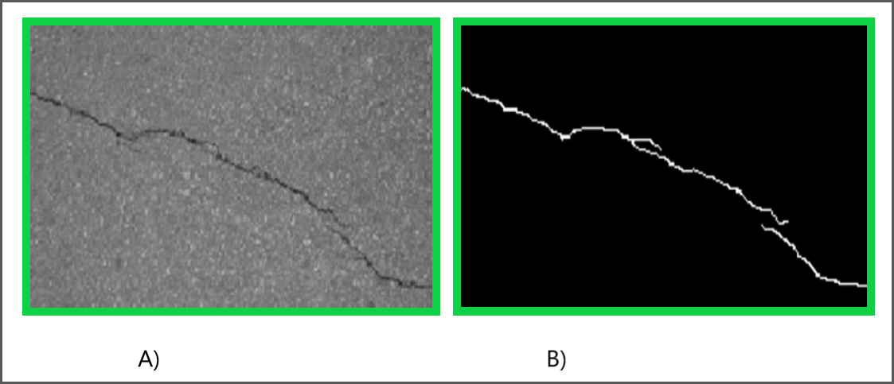
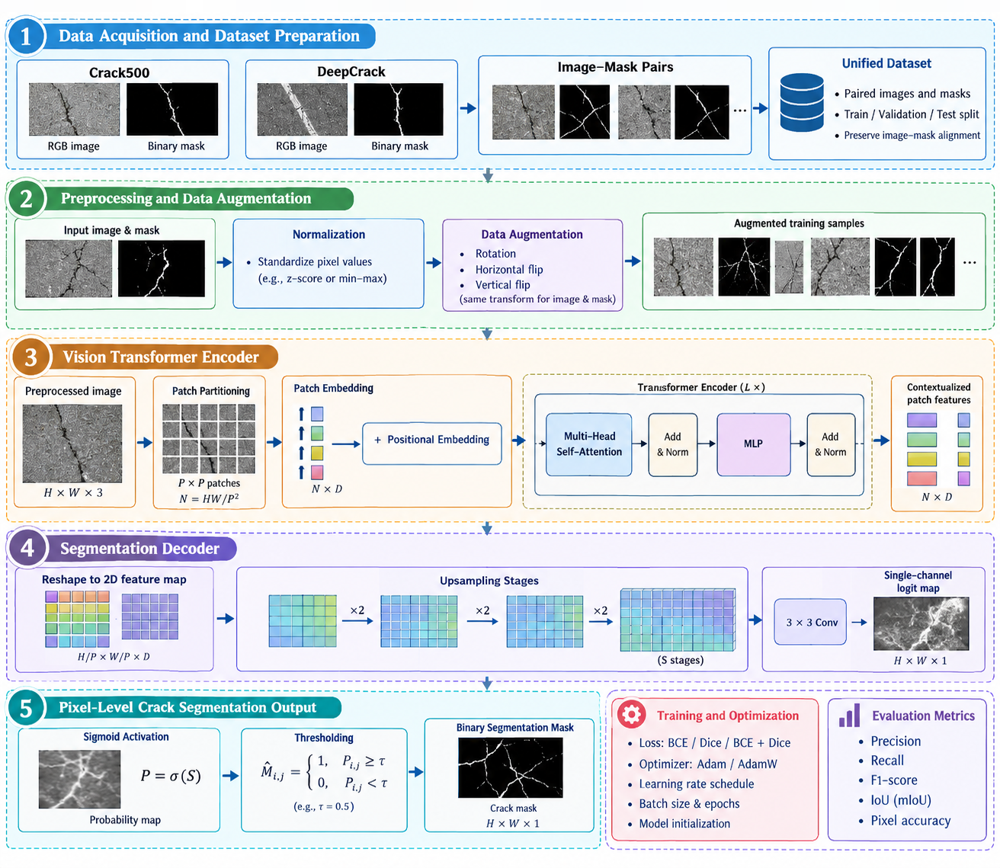
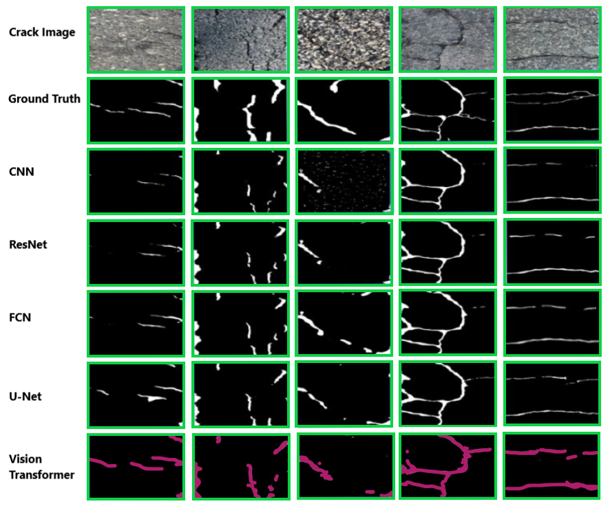
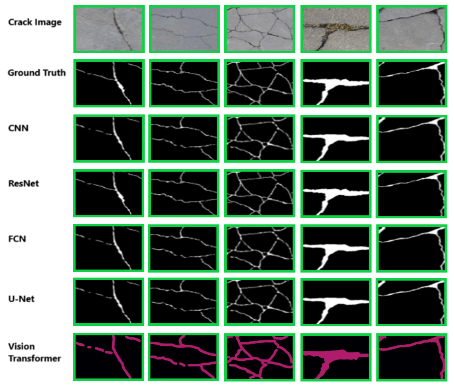

# Pavement ViT Research

**Auditable road-crack segmentation from authentic image–mask data.** A modular PyTorch implementation guided by *Enhancing Road Pavement Crack Detection Using a Vision Transformer Approach* by Muhammad Awais Javeed, Zijie Zhou and Dawei Li.

This project implements patch attention, progressive dense decoding, BCE–Dice training, five defined model families, dataset provenance, evaluation, uncertainty estimates and native-resolution tiled inference. It includes executable verification reports, not a claim to have reproduced the manuscript's accuracy or FPS.

| Research evidence | Meaning |
|---|---|
| [Original manuscript tables](docs/manuscript/) | User-provided claims; not independently verified |
| [Manuscript analysis](docs/manuscript_analysis.md) | Complete section/equation/figure review and implementation decisions |
| [Executed reports](reports/) | Actual local test and short real-data experiment artifacts |
| Full 100-epoch benchmark reproduction | **Not completed**; requires the documented compute and data protocol |
| Original Crack500 250/50/200 protocol | Training originals missing from downloaded official release; strict loader refuses to invent them |

## Research background and contributions

Thin, irregular pavement cracks require both spatial detail and context. A ViT can relate distant image regions; a progressive decoder reconstructs pixel predictions. Sparse foreground makes pixel accuracy alone a weak indicator, so this implementation reports crack precision, recall, F1, crack IoU, background IoU and two-class mean IoU.

The original objective and equal BCE–Dice weighting are preserved. Engineering additions include arbitrary-size padding/cropping, a learnable interpolated positional grid, optional local feature skip, explicit segmentation baselines, train-only normalization, source-scene-aware validation splitting, leakage audits, reproducible seeds, validation-only tuning, atomic checkpoints and structured experimental evidence. Default architecture and optimizer settings are chosen here because AS.docx does not specify them.

## Architecture and workflow


1. Obtain authentic images and masks from the source authors.
2. Preserve original official train/test membership; select validation from training only.
3. Validate pairing, dimensions, binary values, exact/decoded duplicate identities and source-group warnings.
4. Calculate channel mean/std from the selected training images only. Apply synchronized rotations/flips to image/mask pairs; mask resizing is nearest-neighbor.
5. Embed nonoverlapping patches, add interpolated learned positions, apply pre-norm attention/MLP blocks and progressively upsample dense features.
6. Select checkpoints on validation F1. Evaluate the frozen model on held-out data and store actual confusion counts and identities.

## Models and mathematical framework

With patch size $P$, the padded image yields $N=H_pW_p/P^2$ spatial tokens. There is no classification token.

$$Z_0=X_pW_E+E_{pos},\qquad \operatorname{Attention}(Q,K,V)=\operatorname{softmax}(QK^T/\sqrt{d_k})V.$$

Each encoder block uses pre-layer normalization, attention and MLP residual connections. Tokens reshape to a patch grid and pass through $\log_2 P$ upsampling/refinement stages. A final convolution yields logits; output cropping restores the original input dimensions.

$$\mathcal L=0.5\,\mathcal L_{BCEWithLogits}+0.5\left[1-\frac{2\sum_i p_i y_i+\epsilon}{\sum_i p_i+\sum_i y_i+\epsilon}\right].$$

Dice is computed per image and averaged over the batch. In the default loss, positive BCE weight is 1. Optional positive weighting is a separate experiment. Class probability threshold defaults to 0.5; optional selection uses validation only.

| Model | Explicit definition |
|---|---|
| `vit` | Patch embedding + pre-norm global transformer + progressive convolution decoder |
| `cnn` | Three convolution stages with pooling and bilinear dense output |
| `resnet` | ResNet18 encoder from scratch plus a dense prediction head |
| `fcn` | torchvision FCN-ResNet50, one class, no pretrained backbone |
| `unet` | Three-level U-Net with concatenated spatial skip connections |

These are defined comparators; AS.docx's generic CNN/ResNet/FCN names do not identify exact recoverable models. All return `[batch,1,height,width]` logits. [Architecture details](docs/architecture.md).

## Datasets and access

The user confirmed **two binary segmentation datasets**, not four semantic image categories. Four DeepCrack folders mean training images, training masks, test images and test masks.

| Dataset/protocol | Train | Validation | Test | Status |
|---|---:|---:|---:|---|
| DeepCrack | 240 | 60 | 237 | All 537 original pairs acquired; official train/test retained |
| Crack500 original-image manuscript protocol | 250 | 50 | 200 | Original training images unavailable in downloaded official bundle |
| Crack500 published patch alternative | 1,896 | 348 | 1,124 | Authentic upstream crops acquired; different protocol, explicitly labeled |

**Source and license:** [DeepCrack](https://github.com/yhlleo/DeepCrack) restricts use to noncommercial research and education; the authors own only part of the original imagery. [Crack500](https://github.com/fyangneil/pavement-crack-detection) links an official multi-dataset archive but does not supply a blanket redistribution license in its README. Raw images remain local and excluded from ordinary Git. This repository provides a dedicated [`datasets/`](datasets/README.md) directory, portable manifests, identities and source instructions. Uploading complete raw copies requires the relevant redistribution rights; this project does not assert those rights.

Dataset integrity reports record acquired content rather than only quoting expected sizes. Scene-prefix hints are conservative, not certified acquisition IDs. DeepCrack's official splits share three inferred scene prefixes; exact decoded-image duplicates were not found. Training/validation selection keeps inferred scenes together. [Dataset card and limitations](datasets/DATASET_CARD.md).

## Installation

Use Python 3.10–3.12 in a virtual environment. The validated environment uses Python3.12, torch2.6.0 CPU and torchvision0.21.0. The manuscript's historical Python3.6/torch1.10 environment is not the current implementation environment.

```bash
python -m venv .venv
# Linux/macOS: source .venv/bin/activate
# Windows PowerShell: .venv\Scripts\Activate.ps1
python -m pip install torch==2.6.0 torchvision==0.21.0 --index-url https://download.pytorch.org/whl/cpu
python -m pip install -e '.[dev,download]'
python -m pip check
python -m crackvit doctor
python -m crackvit --help
```

For CUDA, install matching torch/torchvision builds from the official PyTorch wheel index appropriate to the GPU and driver; select `train.device: cuda` and optionally `train.amp: true`. CPU is the default and was used for local execution checks. Full global-attention runs at manuscript resolution are substantially more demanding than the smoke configuration. No pretrained weights or external paid API are required.

## Acquire and prepare authentic data

Run commands from this repository's root. Review upstream terms before acknowledging them.

```bash
python -m crackvit download deepcrack --accept-terms
python -m crackvit prepare deepcrack --root datasets/raw/deepcrack --output datasets/manifests/deepcrack.csv --seed 42
python -m crackvit audit --manifest datasets/manifests/deepcrack.csv --root datasets/raw/deepcrack --output reports/deepcrack_audit.json

python -m crackvit download crack500 --accept-terms
python -m crackvit extract-crack500 datasets/downloads/pavement-crack-datasets.zip datasets/raw/crack500
python -m crackvit prepare crack500-patches --root datasets/raw/crack500 --output datasets/manifests/crack500-patches.csv
python -m crackvit audit --manifest datasets/manifests/crack500-patches.csv --root datasets/raw/crack500 --output reports/crack500-patches_audit.json
```

The Crack500 bundle is approximately 1.98 GB. Extract only the relevant nested archives. Original-image mode requires independently obtained `train/`, `val/`, `test/` folders with 250/50/200 RGB images and paired `.png` masks; `prepare crack500` fails when these conditions are not met. Never relabel filtered crops as missing originals.

## Train and evaluate

```bash
# Three-epoch real-data execution check: 24 train / 12 validation images at 96x128.
python -m crackvit train --config configs/smoke.yaml
python -m crackvit evaluate --checkpoint runs/smoke-vit/best.pt --manifest datasets/manifests/deepcrack.csv --root datasets/raw/deepcrack --output runs/smoke-vit/test
python -m crackvit report --run runs/smoke-vit --evaluation runs/smoke-vit/test --output runs/smoke-vit/figures

# Full planned protocol; not claimed to have been run to completion.
python -m crackvit train --config configs/deepcrack.yaml
python -m crackvit evaluate --checkpoint runs/deepcrack-vit/best.pt --manifest datasets/manifests/deepcrack.csv --root datasets/raw/deepcrack --output runs/deepcrack-vit/test

# Restore a stopped run with exactly the same config and data identities.
python -m crackvit train --config configs/deepcrack.yaml --resume runs/deepcrack-vit/last.pt
```

New runs refuse to overwrite existing checkpoints. A resume restores weights, optimizer, scheduler, scaler, epoch, best-score tracking, Python/Torch RNG and loader generator state. Exact equivalence is tested with zero loader workers; multiworker process scheduling and different hardware may still differ. Checkpoints use the PyTorch safe loader and include actual data hashes. Do not load untrusted model files.

## Inference threshold selection and timing

```bash
python -m crackvit threshold --checkpoint runs/smoke-vit/best.pt --manifest datasets/manifests/deepcrack.csv --root datasets/raw/deepcrack --output runs/smoke-vit/threshold.json
python -m crackvit infer --checkpoint runs/smoke-vit/best.pt --image path/to/road.jpg --output runs/prediction --tile 256 --overlap 64
python -m crackvit benchmark --checkpoint runs/smoke-vit/best.pt --output runs/smoke-vit/timing.json --warmup 5 --iterations 30
```

Threshold selection reports a value; pass that frozen value explicitly to `evaluate --threshold` and `infer --threshold`. Do not choose it on test scores. Native-resolution inference blends overlapping tiles with positive cosine weights and writes probability arrays, a binary PNG, an overlay and provenance. Tiling changes available global context relative to full-image inference and must be disclosed. Timing measures batch1 model forward passes with warmup and CUDA synchronization when used, excluding I/O/preprocessing; CPU measurements cannot validate the manuscript's GPU FPS.

## Controlled comparisons tuning and ablations

```bash
# Predefined five-model, three-seed suite with identical data and training settings.
python -m crackvit suite --config configs/deepcrack.yaml --output runs/comparison --models vit cnn resnet fcn unet --seeds 42 43 44
# BCE-only, Dice-only and optional local-skip experiments.
python -m crackvit suite --config configs/deepcrack.yaml --output runs/ablations --models vit --seeds 42 43 44 --ablations
# Learning-rate selection sees validation scores only.
python -m crackvit tune --config configs/deepcrack.yaml --output runs/tuning --learning-rates 0.0001 0.0003 0.001
# Paired image bootstrap from matching frozen test sample identities.
python -m crackvit compare runs/model-a/test/per_image.json runs/model-b/test/per_image.json --output runs/paired_comparison.json
```

`evaluate --allow-cross-domain` explicitly permits a different dataset with the training normalization retained. It rejects known training-image identities in held-out evaluation. Predefine the cross-domain resolution and protocol; do not describe separate per-dataset retraining as domain transfer. Suites and ablation commands are implemented and tested at the pipeline level; full multi-seed benchmark suites remain to be executed.

## Configuration and reproducibility

| Parameter | Research configuration | Provenance |
|---|---|---|
| Input width×height | DeepCrack544×384; Crack500640×360 | Manuscript |
| ViT patch / embedding / layers / heads | 16 / 192 / 6 / 6 | Engineering defaults; unspecified in manuscript |
| MLP ratio / dropout / decoder width | 4 / 0.1 / 128 | Engineering defaults |
| Optimizer / lr / weight decay | AdamW / 0.0003 / 0.01 | Engineering defaults |
| Epochs / batch / early-stop patience | 100 / 4 / 20 | Engineering defaults |
| BCE and Dice weights | 0.5 / 0.5 | Manuscript |
| Threshold | 0.5 | Manuscript permitted default, experimental value not documented |
| Seeds | 42,43,44 for proposed suites | Added replication plan |

Every run records the resolved configuration, sample selection, normalization, environment, data audit, training history, model count, checkpoint hash and optional SQLite registry. [`requirements-lock.txt`](requirements-lock.txt) records the actual local dependency environment. [Reproduction protocol](docs/reproducibility.md).

## Evaluation and uncertainty

$$F_1=\frac{2TP}{2TP+FP+FN},\qquad IoU_{crack}=\frac{TP}{TP+FP+FN}.$$

$$mIoU=\frac12\left[\frac{TP}{TP+FP+FN}+\frac{TN}{TN+FP+FN}\right].$$

The implementation accumulates int64-equivalent Python confusion counts across pixels before calculating dataset-global metrics. Undefined ratios are `null`; mIoU averages defined classes when a class is absent. Reports also include per-image counts, foreground fraction, Brier score, image bootstrap and inferred-scene bootstrap intervals. They do not use independent-pixel bootstraps. Image/scene uncertainty does not substitute for independent training seeds. [Metric conventions](docs/evaluation.md).

## Results and manuscript comparison

**The following are original manuscript claims only.**

| Dataset | ViT precision | Recall | F1 | Pixel accuracy | Reported mIoU | Reported FPS |
|---|---:|---:|---:|---:|---:|---:|
| Crack500 | 87.02% | 94.14% | 90.44% | 90.05% | 81.88% | 22.85 |
| DeepCrack | 92.80% | 90.59% | 91.68% | 91.78% | 84.81% | 21.95 |

These are not generated by this repository. The conditional [numerical audit](reports/manuscript_metric_audit.json) checks identities under global-confusion aggregation; the manuscript does not specify aggregation well enough to “correct” those observations from tables alone. No weights, source predictions or original logs were provided.

Actual short-run measurements live in [`reports/executed/`](reports/executed/) with model, seed, sample counts, resolution, epoch count and the visible label `executed_smoke_not_benchmark_reproduction`. Full accuracy reproduction, statistical superiority, training stability across full seed suites and GPU FPS remain unestablished. Inspect [verification status](reports/verification.json) for exact executed checks.

### Original manuscript figures

These illustrations are copied from the user-provided manuscript at the user's request. They are attributed manuscript content, **not new software outputs**, and are excluded from the software license.

<details>
<summary>Figure 1 — example image and mask</summary>


</details>

<details>
<summary>Figure 2 — proposed architecture</summary>


</details>

<details>
<summary>Figures 3 and 4 — original qualitative comparison claims</summary>



</details>

See [executed result figures](reports/executed/) for plots generated from actual local logs. No original montage is used as training data or treated as quantitative evidence.

## Project structure

```text
ViT/
├── .github/workflows/tests.yml
├── configs/                  # Research, patch-alternative and smoke configurations
├── datasets/
│   ├── DATASET_CARD.md
│   ├── README.md
│   ├── sources.json
│   ├── manifests/            # Portable IDs, splits, image/mask paths and source groups
│   ├── downloads/            # Local authentic archives, ignored by Git
│   └── raw/                  # Local source images and annotations, ignored by Git
├── docs/
│   ├── manuscript/           # Attributed original figures and claim CSV tables
│   ├── manuscript_analysis.md
│   ├── architecture.md
│   ├── evaluation.md
│   ├── reproducibility.md
│   └── implementation_inventory.md
├── reports/                  # Audits, tests, measured smoke results and figures
├── scripts/                  # Manuscript audit and real-data execution verification
├── src/crackvit/
│   ├── cli.py                # Integrated command interface
│   ├── config.py             # Validated experiment settings
│   ├── data/                 # Downloads, extraction, manifests, transforms and statistics
│   ├── models/               # ViT and defined convolutional comparators
│   ├── evaluation/           # Metrics, uncertainty, threshold selection and timing
│   ├── training.py           # Training, selection, checkpointing and resume
│   ├── losses.py
│   ├── inference.py
│   ├── experiments.py        # Predefined model/seed/ablation suites
│   ├── tuning.py             # Validation-only search
│   ├── reporting.py          # PNG/PDF/CSV outputs
│   ├── storage.py            # SQLite run/epoch registry
│   └── utils.py              # Seeds, hashes and environment capture
├── tests/                    # Unit, adversarial data checks and full pipeline integration
├── pyproject.toml
├── requirements.txt
├── requirements-lock.txt
├── CITATION.cff
├── LICENSE
└── THIRD_PARTY_NOTICES.md
```

## Verification

```bash
ruff check src tests scripts
pytest -q --junitxml=reports/test-results.xml
python scripts/verify_real_data.py --output reports/executed/deepcrack
python scripts/verify_real_data.py --dataset crack500-patches --models vit --output reports/executed/crack500-patches
python -m pip check
```

Unit-test geometric fixtures are explicitly synthetic and exist only inside temporary test directories. They are not research datasets or validation evidence. The real-data verification script trains actual models on actual source images, evaluates actual held-out masks and exports its measurements. GitHub Actions provides tests without redistributing or downloading restricted data.

## Limitations and future work

- Exact original model/training reproduction is impossible from the missing manuscript settings and unprovided weights/logs.
- The official downloaded Crack500 release lacks original training images; its patch alternative changes the experimental unit and must be named accurately.
- Benchmark redistribution rights are not implied by public download access. Obtain permission before publishing raw image copies.
- Inferred scene IDs do not certify independence. Official DeepCrack source-group warnings remain visible; consider a separately reported source-disjoint protocol.
- Full-resolution global attention scales quadratically with token count. Tiling limits inference memory while reducing long-range context.
- Short CPU experiments are execution evidence, not publication-quality performance comparisons. Complete full-resolution multi-seed training, controlled ablations and device-matched timing before drawing research conclusions.
- Predicted masks are an aid to infrastructure research. No field inspection, crack-width calibration, real-time service or maintenance decision system has been validated.

## References and attribution

- Javeed, Zhou and Li. *Enhancing Road Pavement Crack Detection Using a Vision Transformer Approach*. User-provided AS.docx; publication status not independently established.
- [Dosovitskiy et al., An Image is Worth 16×16 Words](https://arxiv.org/abs/2010.11929).
- [Yang et al., Feature Pyramid and Hierarchical Boosting Network for Pavement Crack Detection](https://arxiv.org/abs/1901.06340), and the [source repository](https://github.com/fyangneil/pavement-crack-detection).
- [Liu et al., DeepCrack](https://github.com/yhlleo/DeepCrack), Neurocomputing338,139–153,2019. DOI10.1016/j.neucom.2019.01.036.
- [Ronneberger et al., U-Net](https://arxiv.org/abs/1505.04597).
- [PyTorch](https://pytorch.org/) and [torchvision](https://docs.pytorch.org/vision/0.21/).

The manuscript acknowledges grant52432010; that acknowledgment belongs to the manuscript and is not a claim that the grant funded or endorsed this independent software implementation. See [third-party notices](THIRD_PARTY_NOTICES.md) for dataset and manuscript exclusions from the MIT software license.

## Existing calculator

The repository also retains its existing [browser calculator](index.html). Its original [setup and keyboard instructions](docs/calculator_README.md) are preserved separately.
