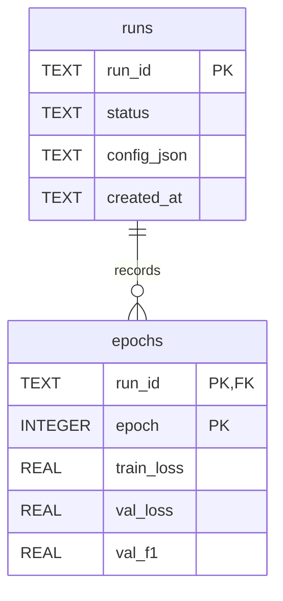

# Architecture and module contracts

The system is a local reproducible research application with a single command interface. It requires no cloud service, credentials or database server for training. The optional registry is SQLite; configurations and evidence remain portable text artifacts.

## Model contract

Every model accepts finite float32 `[B,3,H,W]` standardized RGB tensors and returns raw `[B,1,H,W]` logits. Probabilities are produced only in loss/evaluation/inference. No model downloads pretrained weights implicitly.

ViT processing:

1. Replicate-pad right/bottom to a patch-size multiple. Patch size is a positive power of two.
2. Strided convolution implements flattened patch projection. Interpolate a learned 16×16 positional grid to the actual token grid.
3. Apply independent initialized pre-norm transformer layers with multihead scaled attention, GELU MLP, residuals and final layer norm.
4. Reshape spatial tokens; 1×1 projection initializes the decoder.
5. Repeat bilinear ×2 upsampling, two 3×3 convolution refinements, GroupNorm and GELU for log2(patch_size) stages.
6. Optionally add an independently computed shallow full-resolution feature map. This is a labeled new ablation, disabled by default.
7. Produce a one-channel 3×3 convolution logit map; crop away padding before loss and metrics.

GroupNorm in the custom decoder supports small batches. ResNet/FCN backbones retain their standard BatchNorm behavior and should use adequate training batch size. CNN, U-Net and ResNet18 dense heads are explicitly defined alternatives; they are not asserted to match unknown original baseline settings. FCN uses the torchvision0.21 implementation with ResNet50 from scratch.

## Data contract

Manifests contain `sample_id,dataset,split,image,mask,group`. Paths are relative to an explicit root; path traversal is rejected. Sample IDs include dataset and source folder to avoid official train/test filename collisions. Masks permit values0/1/255 only. Missing pairs, invalid labels, dimension mismatches and cross-split decoded-image duplicates fail audits. Source-scene hints generate visible warnings where official membership is retained. Training/validation splitting groups scene hints and exact duplicates before augmentation.

Training statistics accumulate float64 pixel sums and squared sums on the selected, deterministically resized training images. All other subsets reuse those values. D4 rotations/flips use identical random operations on both members of each pair. These orientation transforms do not interpolate labels; final deterministic mask resizing uses nearest neighbor.

## Execution and checkpoint contract

Configuration is validated against dataclass fields. Misspelled keys and invalid dimensions/loss settings fail early. All experiment paths resolve relative to the working directory; examples assume the repository root. Each run is isolated under its own output directory.

Checkpoints contain configuration, training statistics, manifest/image/mask identities, weights, optimizer/scheduler/scaler state, loader/Python/Torch RNG state, epoch, selection history and run ID. Writes are atomic on the same filesystem. Resume refuses changed config or sample identities. Safe torch loading uses `weights_only=True`. Exact worker-zero restoration is tested; cross-device and multiworker equivalence is not asserted.

## Registry schema

SQLite foreign keys link epochs to runs; `(run_id,epoch)` is unique. Status has an index. Writes use parameterized statements and transactions; connections have bounded busy timeouts. JSON/CSV exports are the interchange format; raw image arrays are not stored in SQL. No database service is warranted for this dataset size.

## Scaling and operational limits

Global attention cost is quadratic in patch-token count. Input360×640 with patch16 requires padding to368×640 and produces920 tokens, versus816 at384×544. These defaults are moderate research choices, not recovered original hyperparameters. The smoke model uses48 dimensions, two layers and patch8 at96×128 and is substantially smaller.

Inference uses positive cosine overlap weights and verifies complete pixel coverage. It preserves original resolution and works for smaller-than-tile images. It changes cross-tile context, so tiled measurements cannot be reported as identical to full-image model behavior.

Logs, stop reasons, metadata, CLI exit codes and versioned configs support batch jobs. This repository does not claim a field-validated real-time inspection product, a REST service or a validated maintenance-decision system.
